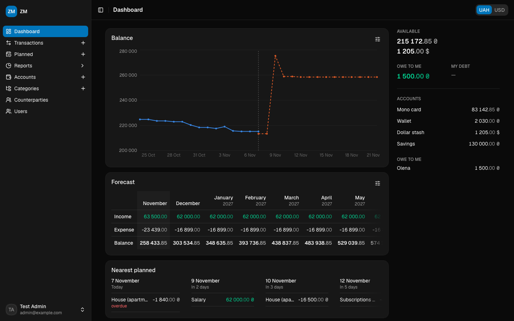
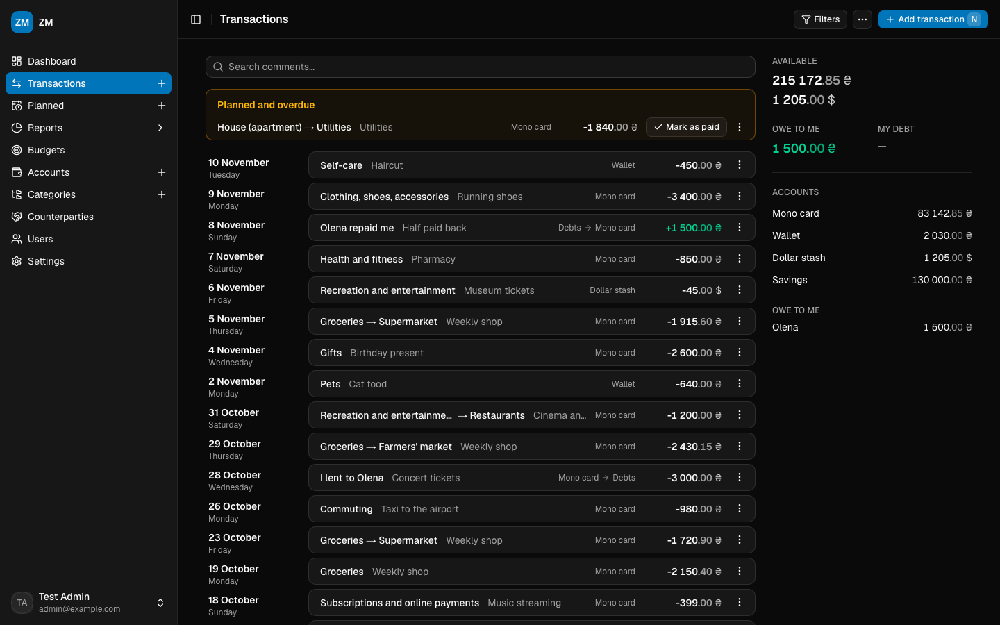
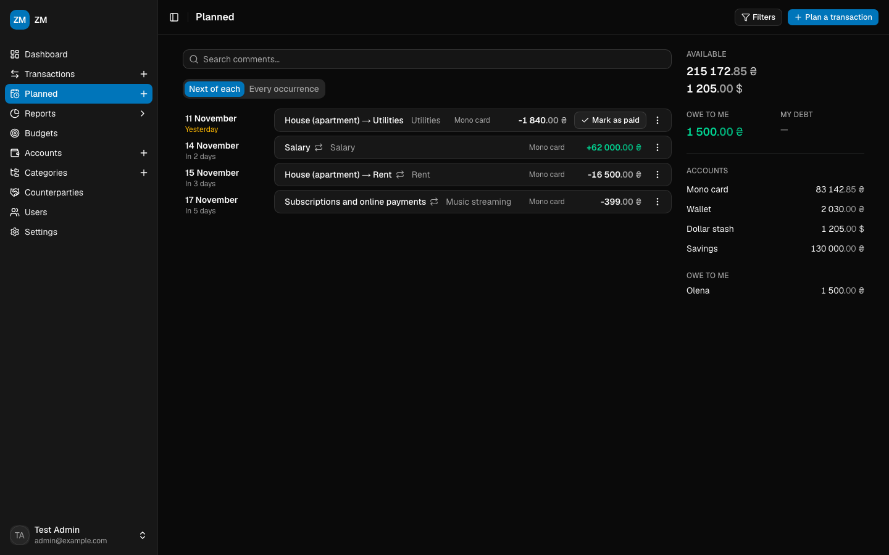
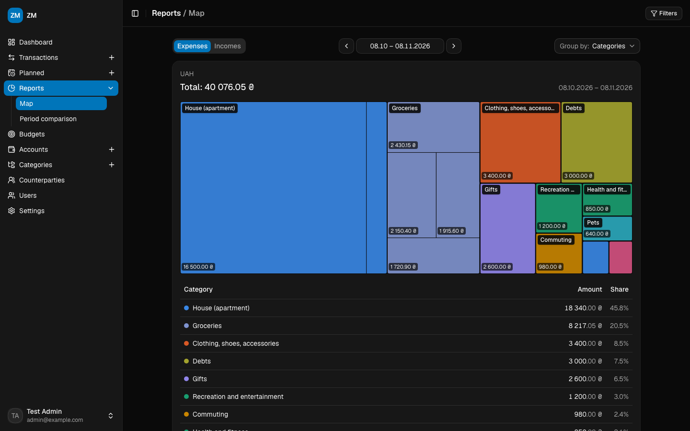
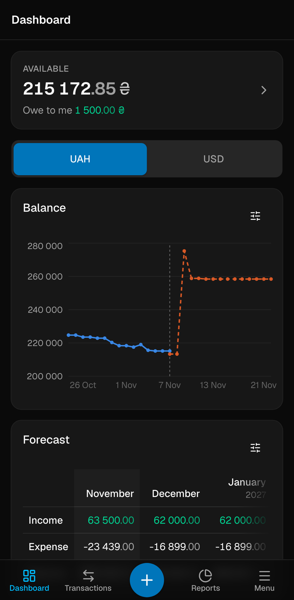
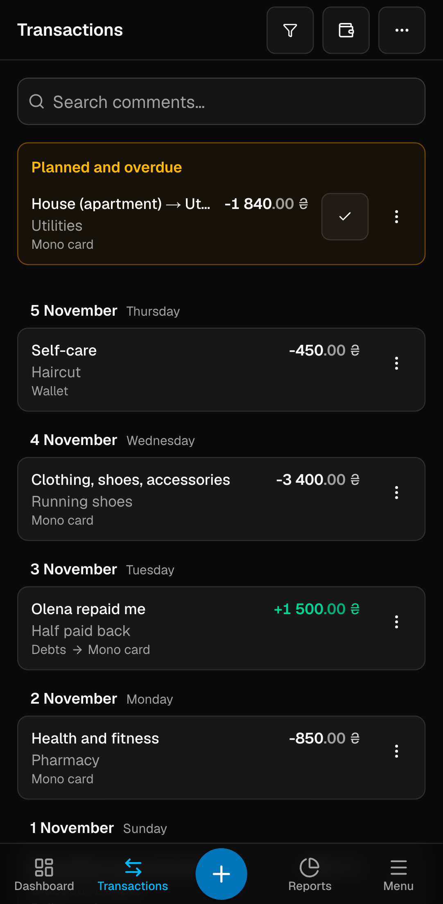

# ZM

**ZM is a private money tracker for you and the people you share money with.**
It helps answer three everyday questions — _where is my money, where did it
go, and will I have enough next month?_ — without handing your accounts or
spending habits to a company. You run it yourself, on your own server or a
hosting service you choose, and only the people you invite can get in.

Most budget apps only show what has already happened. ZM cares just as much
about what is coming: regular bills, salary, money you lent out, and whether
an account is about to run dry.

## What you can do with it

**Track**

- **Keep all your accounts in one place** — cards, cash, savings, in any mix
  of currencies — and see the current balance of each at a glance.
- **Record what happens to your money**: spending, income, moving money
  between your own accounts, and lending or borrowing. Enter things one by
  one or several at once, and correct a balance that drifted from reality in
  a single step.
- **Sort it into categories**, with sub-categories (_Food → Restaurants_),
  then search and filter your history and see the totals for exactly what
  you filtered.

**Plan**

- **Set up regular payments once** — rent, salary, subscriptions — and ZM
  lays them out for the year ahead, reminds you of the ones you missed, and
  emails you the day before a planned payment would push an account below
  zero.
- **Set monthly budgets** for the categories you want to keep an eye on, and
  see how much of each is left.

**Understand**

- **See the big picture** on a dashboard: your balance over time, a forecast
  for the month, this month against the last one, and the next upcoming
  payments.
- **See where it goes** in visual reports: which categories, accounts or
  people take the biggest share of your spending and income, and how one
  period compares with another.
- **Know who owes whom**: money lent to a friend or borrowed from family is
  tracked per person, so you always see what is still owed and what has been
  paid back.

**Share it, and keep it yours**

- **Share with family or a partner**: give someone view-only or full access
  to a particular account or category — handy for a joint household budget.
- **Bring your history with you** from ZenMoney by importing its export
  file, and undo the import in one click if it didn't come out right.
- **Take your data out** whenever you like, as a spreadsheet file or a full
  copy, and look back at the changes you made.
- **Stay secure**: every sign-in needs your password and a code from an
  authenticator app on your phone, with backup codes in case you lose it,
  and a forgotten password can be reset by email.

Available in English and Ukrainian, with light and dark themes, on a computer
or a phone — where it can be added to the home screen like an app.

## Screenshots





| Planned                                  | Reports                                  |
| ---------------------------------------- | ---------------------------------------- |
|  |  |

<p>
  
  &nbsp;
  
</p>

## Getting your own copy

ZM has no public instance: you host it. [SELF-HOSTING.md](SELF-HOSTING.md)
has a step-by-step guide for each way:

- **[Vercel](SELF-HOSTING.md#vercel)** — no server to look after; the free
  tier is enough.
- **[Docker Compose](SELF-HOSTING.md#docker-compose)** — one command on any
  machine with Docker, database included.
- **[A VPS with automatic deploys](SELF-HOSTING.md#self-hosted-with-docker-gitlab-deploy)**
  — the hardened setup, next to other apps on the same server.

Everything below is for people who work on the code.

## Development

### Stack

- **UI**: Next.js 16 (App Router), React 19, Tailwind v4 with shadcn/ui,
  Recharts, next-intl.
- **API**: tRPC, with all server code written in Effect v4 and inputs
  validated by Effect Schema.
- **Data**: Drizzle ORM on PostgreSQL 15+; Redis is optional and holds only
  rate-limit counters.
- **Auth**: better-auth (database sessions, TOTP, admin plugin).
- **Email**: react-email over SMTP.
- **Tooling**: TypeScript, Biome, knip, Vitest, Playwright, Sentry.

The domain rules new code must respect (money in minor units, soft delete,
access control, how debts and planned transactions behave) are in
[AGENTS.md](AGENTS.md).

### Quick start

You need:

- **Node** 24.14.1 or newer on the 24 line (`pnpm install` refuses others);
- **pnpm** — `corepack enable` picks the pinned version;
- **PostgreSQL 15+**. `.env.example` expects
  `postgresql://zm:zm@127.0.0.1:5432/zm`; one way to get it:

  ```shell
  docker run -d --name zm-postgres -p 5432:5432 -e POSTGRES_USER=zm -e POSTGRES_PASSWORD=zm -e POSTGRES_DB=zm postgres:15-alpine
  ```

Then:

```shell
cp .env.example .env        # fill BETTER_AUTH_SECRET and CRON_SECRET
pnpm install
pnpm db:migrate
pnpm dev
```

[localhost:3000](http://localhost:3000) opens the sign-in page.

- **First user.** On an empty database the sign-in page links to
  [/auth/register/invite?id=admin](http://localhost:3000/auth/register/invite?id=admin),
  where you create the admin. The link works only while there is no active
  admin; everyone else joins through an invite link from the Users page.
- **Authenticator codes.** In development `111111` is accepted in place of a
  real one.
- **Language.** The interface follows the browser's language (English or
  Ukrainian, Ukrainian otherwise). Switch it in the top corner of the
  sign-in pages, or in the user menu at the foot of the sidebar.

### Project layout

```text
src/app/          pages, layouts and the API routes (auth, tRPC, cron)
src/components/   UI by feature; ui/ holds the shadcn primitives
src/server/
  api/            tRPC routers: thin, they validate and call a service
  services/       the domain logic, as Effect functions
  jobs/           what the two cron routes run
  db/             Drizzle schema, connection, transactions
  effect/         runtime, config, mailer and Redis services
  auth/           better-auth setup and its hooks
src/lib/          pure helpers shared with the client (money, dates, validators)
src/messages/     en.json and uk.json
emails/           react-email templates
drizzle/          SQL migrations
scripts/          migrate, cron and v1-import entry points
tests/            Vitest: unit, api, services, server, contract
e2e/              Playwright specs and the demo seed
```

### Commands

| Command                 | What it does                                             |
| ----------------------- | -------------------------------------------------------- |
| `pnpm dev`              | the dev server on :3000                                  |
| `pnpm email`            | previews the email templates on :3001                    |
| `pnpm check`            | Biome lint and format check (`check:write` fixes)        |
| `pnpm typecheck`        | generates the route types, then `tsc`                    |
| `pnpm knip`             | unused files, exports and dependencies                   |
| `pnpm db:generate`      | a new migration after editing the Drizzle schema         |
| `pnpm db:migrate`       | applies the migrations to `DATABASE_URL`                 |
| `pnpm db:check`         | checks the migration files for conflicts                 |
| `pnpm db:studio`        | browses the database                                     |
| `pnpm test`             | the Vitest suite (`test:watch` reruns on change)         |
| `pnpm test:e2e`         | the browser tests                                        |
| `pnpm build:selfhosted` | the standalone bundle in `dist/`, as deployed            |
| `pnpm smoke`            | boots `dist/` with `.env` and requests one rendered page |
| `pnpm screenshots`      | regenerates the images above from a seeded demo          |
| `pnpm check-updates`    | lists newer dependency versions (`-u` writes them)       |

### Configuration

Environment variables are validated at startup by `src/env.ts`, and
`.env.example` documents each one. An empty value counts as unset.

Required:

| Variable             |                                                              |
| -------------------- | ------------------------------------------------------------ |
| `DATABASE_URL`       | the Postgres connection URL                                  |
| `BETTER_AUTH_SECRET` | at least 32 characters (`openssl rand -base64 32`)           |
| `CRON_SECRET`        | at least 16 characters; the bearer token for the cron routes |

Optional:

| Variable                                                                                                |                                                                                                                   |
| ------------------------------------------------------------------------------------------------------- | ----------------------------------------------------------------------------------------------------------------- |
| `BETTER_AUTH_URL`                                                                                       | the public URL; on Vercel `VERCEL_URL` is used when empty                                                         |
| `APP_TIMEZONE`                                                                                          | what "today" means for overdue checks, cron and imports; default `Europe/Kyiv`                                    |
| `TRANSACTIONS_PAGINATION_LIMIT`                                                                         | page size of the transaction list; default 50                                                                     |
| `REDIS_URL`                                                                                             | `redis://` or `rediss://`; keeps rate-limit counters in Redis instead of Postgres, which stays the fallback       |
| `MAIL_HOST`, `MAIL_PORT`, `MAIL_USERNAME`, `MAIL_PASSWORD`, `MAIL_FROM`                                 | SMTP over TLS for alerts and password resets; `MAIL_FROM` defaults to `MAIL_USERNAME`                             |
| `NEXT_PUBLIC_SENTRY_DSN`, `NEXT_PUBLIC_SENTRY_ENV`, `SENTRY_ORG`, `SENTRY_PROJECT`, `SENTRY_AUTH_TOKEN` | Sentry; the last three upload source maps at build time                                                           |
| `DATABASE_SOCKET_PATH`                                                                                  | a Postgres Unix socket, e.g. `/var/run/postgresql/.s.PGSQL.5432`; the host and port in `DATABASE_URL` are ignored |
| `DATABASE_LOG`                                                                                          | `true` logs every query                                                                                           |

### Testing

The Vitest suite calls the tRPC procedures, route handlers and better-auth's
HTTP handler against a real Postgres, so it needs Docker:

```shell
pnpm test           # starts docker-compose.test.yml (postgres 5433, redis 6380) on first run
pnpm test:tz        # the date tests with a non-UTC APP_TIMEZONE
pnpm test:db:down   # stop and remove the test database and redis
```

- Configuration lives in `.env.test`. Variables already set in the
  environment win, which is how CI points the suite at its own services
  (with `TEST_DB_AUTOSTART=0`, so nothing reaches for Docker).
- If port 5433 is taken: `ZM_TEST_DB_PORT=5434 pnpm test:db:up`, then
  override `DATABASE_URL` to match.
- Every table except `currencies` is truncated between tests, so the suite
  refuses a `DATABASE_URL` that doesn't name a `zm_test` database.
- `TEST_REDIS_URL` is used only by the Redis rate-limit store's own tests;
  everything else counts rate limits in Postgres.

#### Browser tests

Playwright drives the built standalone bundle (`dist/server.js`) in desktop
Chrome and on a Pixel 7: the admin bootstrap and sign-in with TOTP, every
page through the sidebar or the mobile menu, and a money journey (account,
expense, income, planned payment, report). Any console error or uncaught
exception fails the test, which is what catches most breakage after a
dependency upgrade.

```shell
pnpm exec playwright install chromium   # once, and after a Playwright upgrade
pnpm test:e2e                  # builds dist/, then runs the setup, anonymous, desktop and mobile projects
pnpm test:e2e:ui               # the same in Playwright's UI mode
E2E_PREBUILT=1 pnpm test:e2e   # reuse an existing dist/ (skips the ~1 min build)
E2E_DEV=1 pnpm test:e2e        # against `next dev`, for writing specs (stop your own `pnpm dev` first)
```

The app is served on port 3100 (`E2E_PORT`) from a throwaway `zm_e2e`
database on the same Docker postgres as `pnpm test`, recreated on every run
(`E2E_DATABASE_URL` points it elsewhere). Screenshots of every page at phone
width land in `test-results/`.

`pnpm screenshots` uses the same server and database: after the admin
bootstrap it seeds a few months of demo data through the API
(`e2e/demo.setup.ts`) and saves the README images to `docs/screenshots/`.

#### Upgrading dependencies

```shell
pnpm check-updates -u && pnpm install
pnpm test && pnpm test:e2e
```

pnpm installs only versions published at least a day ago
(`minimumReleaseAge` in `pnpm-workspace.yaml`).

### CI

- **GitHub Actions** (`.github/workflows/`) gates pull requests, mostly
  Dependabot's: `biome ci`, `knip`, the typecheck, both test runs, the
  migration drift check, a smoke test of the standalone bundle
  (`smoke-standalone.sh`) and the browser tests against that bundle.
- **GitLab** (`.gitlab-ci.yml`) runs lint, typecheck and tests on `main`.
  Once they pass it builds the Docker image, has it migrate an empty
  database and render a page from a read-only filesystem, pushes it to the
  registry and deploys it to the server
  (see [SELF-HOSTING.md](SELF-HOSTING.md#self-hosted-with-docker-gitlab-deploy)).

## License

Copyright (c) 2026 kspworks. All rights reserved.

The source is public for reference. No license is granted to use, copy,
modify or distribute it. To report a vulnerability, see
[SECURITY.md](SECURITY.md).
