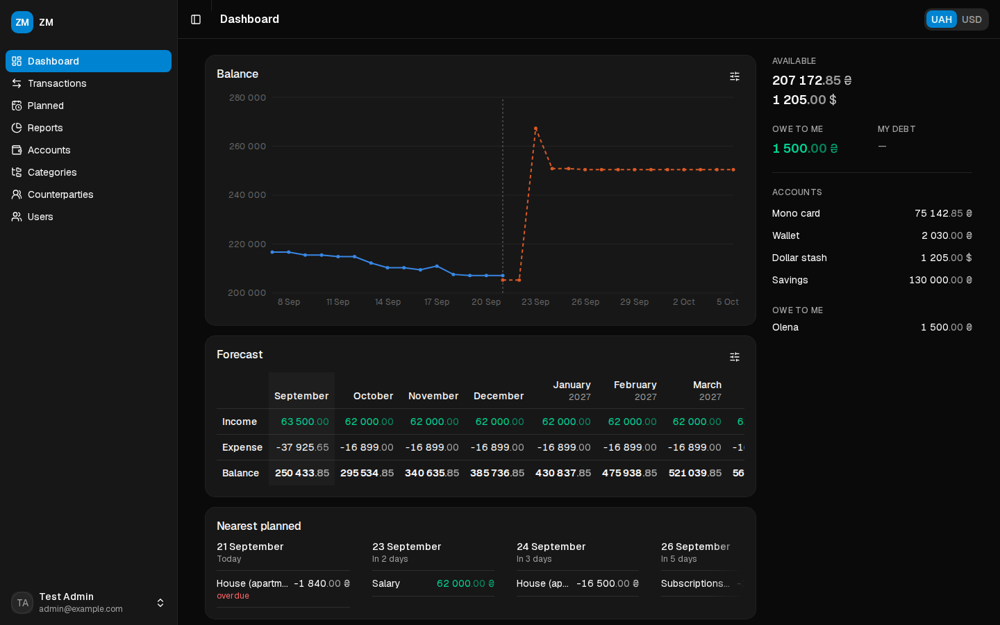
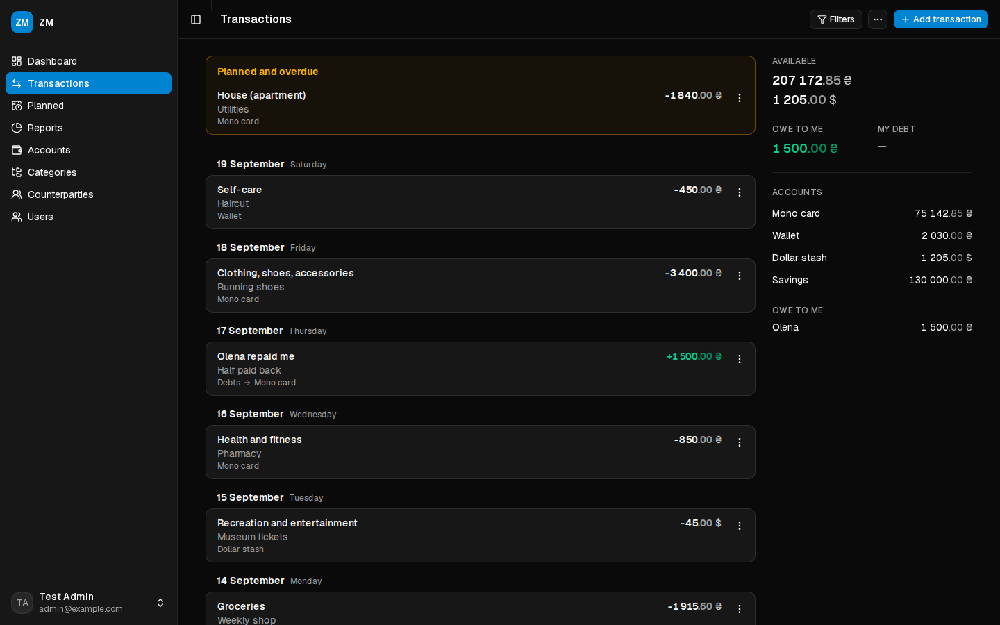
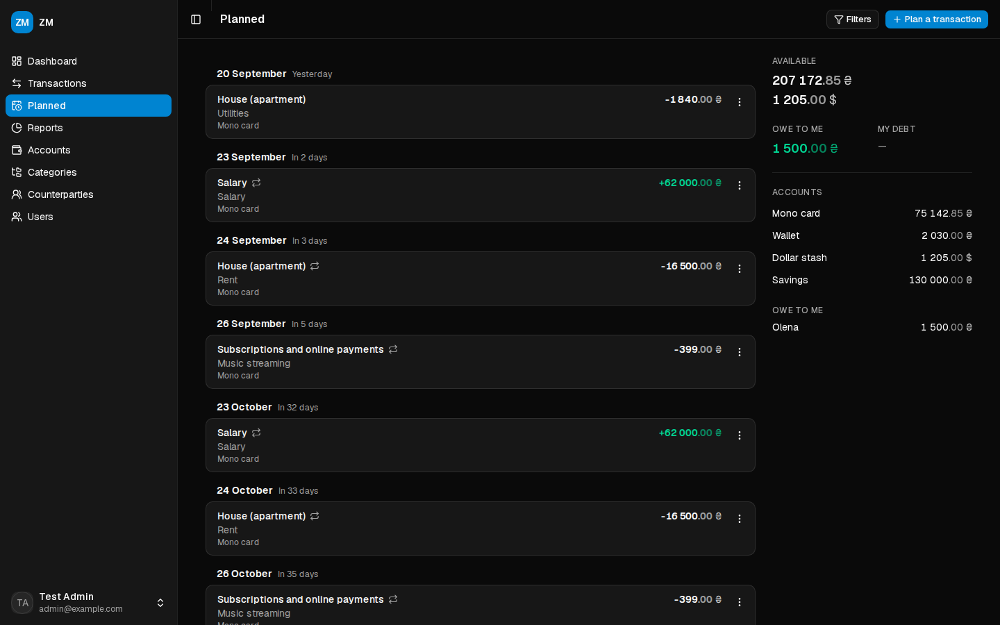
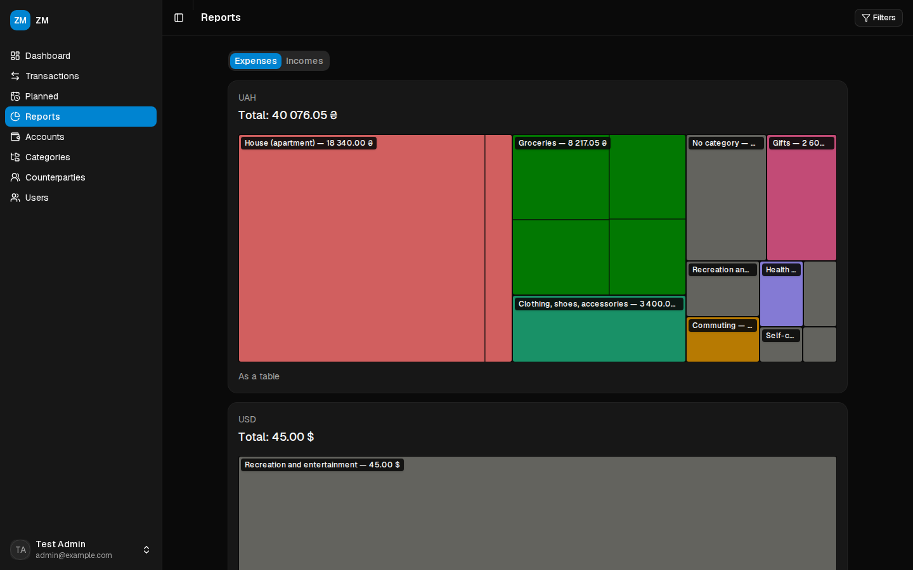
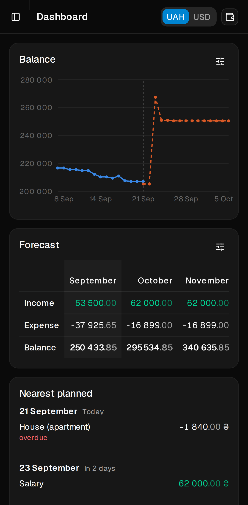
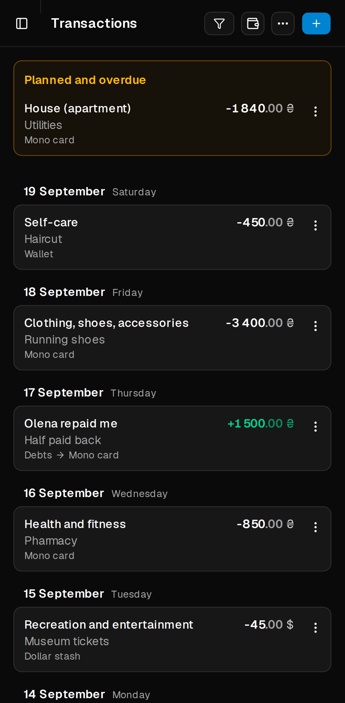

# ZM

A self-hosted, invite-only personal budget manager:

- accounts in several currencies; expenses, incomes, transfers and debts,
  entered one at a time or in bulk, plus a one-step balance adjustment;
- two-level categories, and a filterable transaction list with totals over
  the whole filtered set;
- planned (recurring) transactions with overdue reminders, and email alerts
  when tomorrow's planned payments would overdraw an account;
- per-person debt tracking (lent, borrowed, repaid);
- a dashboard with a balance chart, a monthly forecast and the nearest
  planned payments; treemap reports of expenses and incomes;
- accounts and categories shared with other users, read-only or read-write;
- ZenMoney CSV import that can be undone;
- sign-in with a password plus a mandatory authenticator app (TOTP) and
  backup codes, password reset by email, and admin-issued invite links.

English and Ukrainian, light and dark.

## Screenshots





| Planned | Reports |
|---|---|
|  |  |

<p>
  
  &nbsp;
  
</p>

`pnpm screenshots` regenerates these: it builds the app like
`pnpm test:e2e` does, seeds a few months of demo data through the API
(`e2e/demo.setup.ts`) and saves the images to `docs/screenshots/`.

## Stack

Next.js (App Router), TypeScript, tRPC, Drizzle ORM on PostgreSQL 15+,
better-auth (database sessions, TOTP, admin plugin), next-intl, Tailwind v4
with shadcn/ui, react-email, vitest, Biome.

The domain rules new code must respect (money in minor units, soft delete,
access control, how debts and planned transactions behave) are in
[AGENTS.md](AGENTS.md).

## Local development

You need Node 24 (`.nvmrc`), pnpm (`corepack enable` picks the pinned
version) and PostgreSQL 15+. `.env.example` expects
`postgresql://zm:zm@127.0.0.1:5432/zm`; one way to get it:

```shell
docker run -d --name zm-postgres -p 5432:5432 -e POSTGRES_USER=zm -e POSTGRES_PASSWORD=zm -e POSTGRES_DB=zm postgres:15-alpine
```

Then:

```shell
cp .env.example .env        # fill BETTER_AUTH_SECRET and CRON_SECRET
pnpm install
pnpm run db:migrate
pnpm dev
```

Create the first (admin) user at
[/auth/register/invite?id=admin](http://localhost:3000/auth/register/invite?id=admin).
That link only works while there is no active admin; everyone else joins
through an invite link from the Users page. In development the code
`111111` is accepted in place of an authenticator code.

Other everyday commands:

```shell
pnpm check          # Biome lint and format check (check:write fixes)
pnpm typecheck
pnpm knip           # unused files, exports and dependencies
pnpm db:generate    # a new migration after editing the Drizzle schema
pnpm db:studio      # browse the database
pnpm email          # preview the email templates on :3001
```

## Configuration

Environment variables are validated at startup by `src/env.ts`;
`.env.example` documents each one.

| Variable | |
|---|---|
| `DATABASE_URL` | required |
| `BETTER_AUTH_SECRET` | required, at least 32 characters (`openssl rand -base64 32`) |
| `CRON_SECRET` | required, at least 16 characters; the bearer token for the cron routes |
| `BETTER_AUTH_URL` | the public URL; on Vercel `VERCEL_URL` is used when empty |
| `APP_TIMEZONE` | what "today" means for overdue checks, cron and imports; default `Europe/Kyiv` |
| `TRANSACTIONS_PAGINATION_LIMIT` | page size of the transaction list; default 50 |
| `MAIL_HOST`, `MAIL_PORT`, `MAIL_USERNAME`, `MAIL_PASSWORD`, `MAIL_FROM` | optional SMTP (TLS) for alerts and password resets |
| `NEXT_PUBLIC_SENTRY_DSN`, `NEXT_PUBLIC_SENTRY_ENV`, `SENTRY_ORG`, `SENTRY_PROJECT`, `SENTRY_AUTH_TOKEN` | optional Sentry |
| `DATABASE_LOG` | `true` logs every query |

## Tests

The suite calls the tRPC procedures, route handlers and better-auth's HTTP
handler against a real Postgres, so it needs Docker:

```shell
pnpm test           # starts docker-compose.test.yml (port 5433, tmpfs) on first run
pnpm test:tz        # the date tests with a non-UTC APP_TIMEZONE
pnpm test:db:down   # stop and remove the test database
```

Configuration lives in `.env.test`; variables already set in the environment
win, which is how CI (and a machine where port 5433 is taken:
`ZM_TEST_DB_PORT=5434 pnpm test:db:up`, then override `DATABASE_URL`) points
the suite at another database. Every table except `currencies` is truncated
between tests.

### Browser tests

Playwright drives the built standalone bundle (`dist/server.js`) in desktop
Chrome and on a Pixel 7: the admin bootstrap and sign-in with TOTP, every page
through the sidebar or the mobile menu sheet, and a money journey (account,
expense, income, planned payment, report). Any console error or uncaught
exception fails the test, which is what catches most breakage after a
dependency upgrade. They use a throwaway `zm_e2e` database on the same Docker
postgres as `pnpm test`, recreated on every run.

```shell
pnpm exec playwright install chromium   # once, and after a Playwright upgrade
pnpm test:e2e      # builds dist/, then runs the setup, anonymous, desktop and mobile projects
pnpm test:e2e:ui   # the same in Playwright's UI mode
E2E_PREBUILT=1 pnpm test:e2e   # reuse an existing dist/ (skips the ~1 min build)
E2E_DEV=1 pnpm test:e2e        # against `next dev`, for writing specs (stop your own `pnpm dev` first)
```

After `pnpm check-updates -u && pnpm install`, run `pnpm test && pnpm test:e2e`.
Screenshots of every page at phone width land in `test-results/`.

### CI

- **GitHub Actions** (`.github/workflows/`) gates pull requests, mostly
  Dependabot's: `biome ci`, `knip`, the typecheck, both test runs, the
  migration drift check, a smoke test of the standalone bundle
  (`smoke-standalone.sh`) and the browser tests against that bundle.
- **GitLab** (`.gitlab-ci.yml`) runs lint, typecheck, tests and a build on
  `dev` → `main` merge requests, and deploys `main` to the pm2 server
  (see [SELF-HOSTING.md](SELF-HOSTING.md)).

## Deploying with docker-compose

- `cp .env.docker.example .env.docker` and fill in `BETTER_AUTH_SECRET`,
  `BETTER_AUTH_URL` and `CRON_SECRET`. The app refuses to start without them.
- **Change the Postgres password**, in `docker-compose.yml` and in
  `DATABASE_URL`. The example one is public: it is in this repository.
- `docker compose up --wait` and open [http://localhost:3333](http://localhost:3333).

A `migrator` service applies the migrations and must exit successfully before
`next-app` starts, so the schema is never behind the code. The cron jobs
(below) are plain HTTP calls; from the host, for example:

```shell
curl -fsS -H "Authorization: Bearer $CRON_SECRET" http://localhost:3333/api/cron/daily-0000
```

## Cron jobs

| Route | When | What |
|---|---|---|
| `/api/cron/daily-0000` | 00:00 in `APP_TIMEZONE` | rolls the one-year planned window forward, sweeps rate-limit rows |
| `/api/cron/daily-0900` | 09:00 in `APP_TIMEZONE` | emails readers of accounts that tomorrow's planned transactions would overdraw |

Both answer only `Authorization: Bearer <CRON_SECRET>` and return plain-text
logs. Self-hosted installs call them from system cron, e.g.
`0 0 * * *` and `0 9 * * *` in a crontab running in the app's time zone.

## Migrating from v1

On an empty, migrated database:

```shell
OLD_DATABASE_URL=postgres://… DATABASE_URL=postgres://… \
BETTER_AUTH_SECRET=<the production secret> pnpm run migrate:v1
```

It runs in one transaction, refuses a target that already has users, keeps
v1 passwords (bcrypt, rehashed on the next sign-in) and authenticators, turns
payees into counterparties (merging case variants, reported), and prints
row counts, balance mismatches and transactions per kind.

## Self-hosting

A step-by-step Vercel guide and the pm2 setup are in
[SELF-HOSTING.md](SELF-HOSTING.md).
